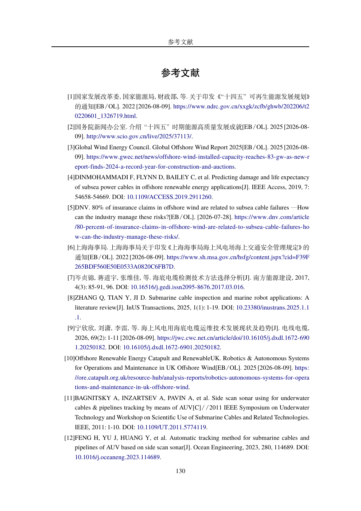
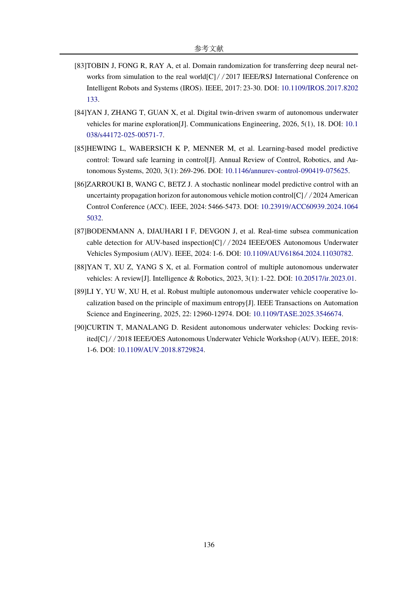
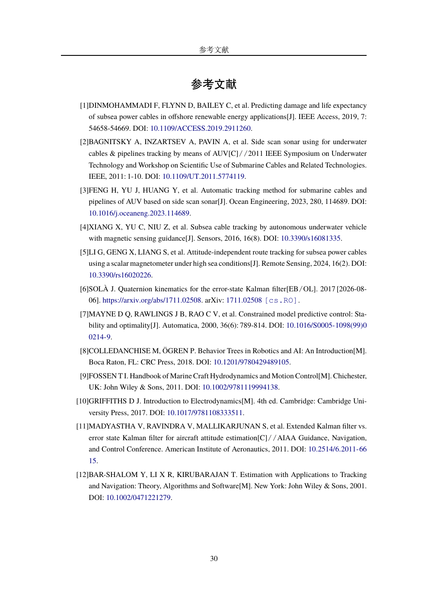

# 2026-10-18 参考文献治理交付与验收

全量审计及安全修正已经完成，文献库尚未获得终稿真实性全量放行。工具与编译验收通过；必要字段仍有 23 条待复核，其中主论文实际引用 20 条。仅页码问题没有进入必要人工复核清单。

本轮不修改算法、研究结论、实验数据或章节正文。主论文仍为 170 页，两种中期报告均为 34 页。所有 99 个研究库 citekey 保持一致，没有替换或删除文献。依赖已安装在用户原生文件系统的隔离环境中，避免 VirtualBox 共享目录不支持软链接的问题。

## 覆盖与可追溯性

| 指标 | 结果 | 证据 |
|---|---:|---|
| Bib 库/全部条目 | 13 / 333 | [全量 JSON](audit_results.json) |
| 研究库 | 99 | `thuthesis/ref/auv-references.bib` |
| 模板示例及测试库 | 117 | 单独标为 template_fixture |
| vendor 同版副本 | 117 | 单独标为 upstream_vendor，不改写 |
| 研究文献身份已核实 | 94 / 99 | identity_verified，非全字段放行 |
| 研究文献必要字段已通过 | 76 / 99 | manual_review_required=false |
| VERIFIED 字段证据完整性检查 | 882 / 882 | [验收 JSON](acceptance.json)，研究库其中 664 个 |
| 主论文实际引用 / BBL 书目 | 90 / 90 | [实际文献表](compiled/auv-thesis_bibliography.txt) |
| 两份中期报告实际引用 / BBL 书目 | 各 12 / 12 | [main](compiled/auv-middle-defense-main_bibliography.txt)、[school](compiled/auv-middle-defense-school_bibliography.txt) |
| 未定义正文引用 | 0 | BCF、BBL 与静态图共同检查 |
| 自动测试 | 28 / 28 | [测试日志](tests.log) |
| 离线重复结果 | 一致 | 除运行生成时间外逐条 JSON 相同；[重放日志](replay.log) |

中期报告静态分支并集含 13 键，实际正式报告为 12 键。`hewing2020learning` 仅在 `MiddleSmoke` 的格式测试分支中；工具保留这一差异，不将未执行分支误报为正文漏引。研究库主论文未引用的 9 条也在审计中逐条保留，未静默忽略。

研究库字段状态为 VERIFIED 664、NOT_APPLICABLE 357、UNVERIFIABLE 58、MISMATCH 9、SOURCE_CONFLICT 1。接口被阻断、超时或检索不到绝不作为“文献不存在”结论。5 条当前仍未充分确认所指资源身份的记录为 `scio2025energyachievement`、`gwec2025offshore`、`scio2026offshore`、`geomatching2022sbp`、`fsea_p200`；其中包含报告发布页与报告本体、主页代替文章、404 和空页面等情况，不能由真实机构名推定每条题录正确。

## 实际安全修改

修改依据在 [首次候选及证据](before/safe_changes.json)、[首次完整 diff](before/safe_corrections.patch) 和 [补充明确文章编号 diff](before/add-confirmed-eid.patch) 中保留。首次候选的缺失 `eid` 添加在第二个补丁落实，合计 54 项字段/著录处理；另加 3 行审计索引注释。

- 1 处 DOI 拼写修正：`wunderlich2016burial` 的 `10.23784/HN105_11` 改为官方文章页给出的 `10.23784/HN105-11`。题名、作者、期刊、年份、期号、页码与同一官方来源核对，未更换文献身份。
- 6 处已明确的 article-number/paper ID 从 `pages` 移到 `eid`；另给 `yan2026digitaltwin` 添加 Crossref 明确登记的 `eid=18`。
- 13 个只有单一数字、无法充分确认其语义的 `pages` 省略，既不猜测页码区间，也不擅自移作文章编号。原值、候选和外部响应仍可追溯。这些是元数据可得性限制，不直接证明原数字错误。
- 3 处会议名称对齐正式记录，不更改论文内容或 citekey。
- DL/T 1278—2025 从 `online` 改为 `standard`，由正式行业标准目录支持其类别；责任者等必要字段仍按真实证据边界保留未通过状态。
- 29 处项目检索、技术说明或“待核对”性质的 `note` 移为 `audit-note` 注释，避免打印在正式书目中；原说明保留在源码和备份。

最终再次审计后 `safe_candidates=0`；9 个争议字段只输出 [审阅差异](review_fields.diff) 与 [带证据建议](review_changes.json)，没有应用。其他无法核实的字段均在 [未验证清单](unverified_entries.json) 中，不为了降低异常数而补写 DOI、出版年、页码或正式标准号。

完整原 Bib 与修正前 PDF 存于 [before](before/)；[输入、工具及原文件 SHA-256](inputs.sha256)、[环境版本](environment.txt) 支持复现。冻结备份不被本轮构建覆盖。工作区没有自动提交或推送。

## 需要人工处理的边界

唯一正式入口是 [必要字段清单](manual_review.md)；[页码等次要清单](secondary_review.md) 不要求作者逐条确认后才可继续写作。

优先处理：

1. `tcsgpc_cable`：官方证据为中国测绘学会征求意见稿，原库责任者却是中国海洋工程咨询协会。是否引用该稿或其他已发布标准涉及文献选择及正文含义，未擅自替换。
2. `haiying_t180`：官网列示海鹰加科海洋技术公司，原库为电子医疗系统公司；需要确认责任者，不能仅以“海鹰”品牌相同放行。
3. `barshalom2001estimation`：纸本 2001 与电子 DOI 记录 2002 存在版本差异，保留 SOURCE_CONFLICT；未把纸本年直接改成电子版年。
4. 报告/产品手册的责任者和出版日期：赞助方、托管机构、项目完成时间、文件中测试日期与页面版权年份不能自动作为作者或出版年。例如当前 HydroPACT 350 规格书 PDF 已是带 2026 版权的版本，不能据此确认原库声称的 2021 年版本。
5. 两条老 IEEE 会议文献的登记记录出版日期为 null；不会输出 `year=None`，也不从题名内的年份补写。补探 DBLP 导出遇到机器访问挑战，未当成功；可由正式论文首页或有日期的会议题录解决。

这些条目不是判定为“伪造”，而是不能按目前证据宣称必要字段已核验。正文论断是否由原文支持（L3）未实施，本次 L1/L2 核验不替代该工作。

## 编译、格式与逐项验收

执行过 `make auv-thesis auv-middle-defense-main auv-middle-defense-school`，三份 PDF 均通过引用和 Biber 检查。主论文无新增 undefined、Missing character、Overfull 或 Biber WARN/ERROR；既有 Underfull 提示不影响引用。参考文献实际输出使用 `gb7714-2015`，标准电子载体 `[S/OL]`、期刊 `[J]`、会议 `[C]`、专著 `[M]` 与在线资源 `[EB/OL]` 已检查，项目内部核验说明未泄露到书目。个别元数据仍未齐全，因此这里仅确认格式管线和当前渲染，不能声称所有条目的 GB/T 7714 信息完整性均已满足。

| 原请求 | 验收 |
|---|---|
| 自动发现全部 Bib、扫描引用、标明未引与未定义键 | 通过，333 条完整列账，实际引用独立核对 |
| 外部权威源核验及访问降级 | 通过，Crossref/DataCite、期刊官网、官方报告/手册、机构库；访问失败保留 |
| 逐字段状态与原始值、建议值 | 通过，[CSV](field_differences.csv) / [JSON](audit_results.json) |
| 严格区分页码与文章编号 | 通过，不使用 PDF 总页数推算 |
| 不用内部知识或接口失败冒充验证 | 通过；明确来源和失败记录，不按数据库数投票 |
| 每个 VERIFIED 都能追溯 | 通过，882 个字段证据元数据及响应 SHA 均核对 |
| 确定性修正与争议 diff 分离 | 通过，安全候选已清零；争议未应用 |
| citekey 兼容、重编译与最终书目检查 | 通过，主论文 170 页、两报告各 34 页 |
| 报告、差异、未验证条目及人工事项 | 已交付；必要字段与页码清单分开 |
| 自动测试、限速/网络/权限/冲突降级 | 28 项通过；离线同证据重放一致 |
| 研究文献必要字段全部放行 | **未通过**，23 条待复核；严格门禁必须非零退出 |

实际构建日志：[主论文](compile-thesis.log)、[两报告](compile-reports.log)、[补充修正后的最终构建](compile-final.log)。[机器验收](acceptance.json) 的 `audit_acceptance_passed=true`、`release_ready=false` 分别对应上表，不能混用。

抽查渲染页：

